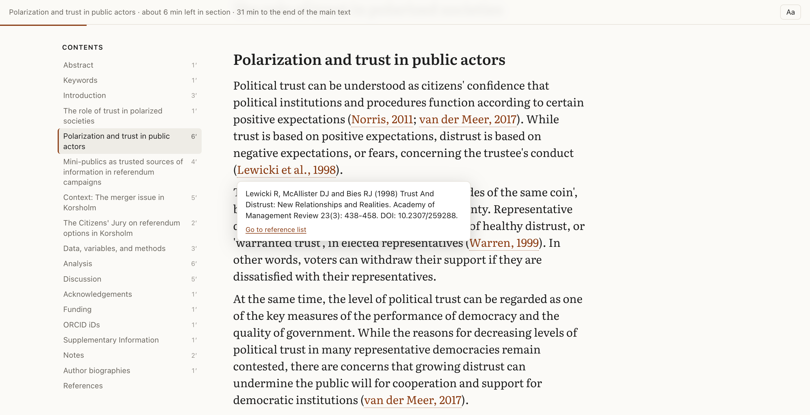

# lit-reader

lit-reader turns an academic paper into an offline HTML reading copy, with reflowed text, a contents sidebar, citation cards, sidenotes and a saved reading position.



<sub>Shown: Setälä, Christensen, Leino and Strandberg, "Beyond polarization and selective trust", *Politics* (2021), doi:10.1177/02633957211024474, CC BY-NC.</sub>

## Why lit-reader

Most academic papers are published as PDFs laid out for print, which makes them hard work to read on a laptop. lit-reader is for researchers, students, journalists and anyone else who reads papers closely on a screen. It resets the paper for long reading and never summarises or rewrites it. Conversion can still lose or garble text, so lit-reader reports how much of the text reached the page.

Unlike most PDF viewers, which show you the printed page, lit-reader reflows the text from PDFs and adds tools for reading it:

- **Text set for reading.** By default, lines run to about 65 characters, and lit-reader adds no automatic hyphenation. Long paragraphs are split at sentence ends, and an "As published" setting restores the original breaks.
- **Citations that open in place.** Click a citation to read the reference in a card without losing your place. Footnotes sit in the margin, except in papers built from a PDF, where they follow the paragraph.
- **A sense of where you are.** The contents sidebar shows the minutes in each section, and the Contents button hides it when you want only the text. The top bar shows the time left, and the page reopens where you stopped. Papers built from a PDF also keep their original page numbers in the margin.
- **Quotes saved with their citation.** Select a passage and choose "Save quote", or press Q. The Quotes button in the top bar copies each quote with its author, year and page, or downloads them all as a Markdown file. Page numbers come only from papers built from a PDF.
- **Settings for your own eyes.** You can change the theme, font, size, line length and line spacing. People read fastest in different fonts, and [the font you like best may not be your fastest](https://research.adobe.com/publication/towards-individuated-reading-experiences-different-fonts-increase-reading-speed-for-different-individuals).
- **A check on the build.** lit-reader reports the share of the source's words that reached the page and lists any long passages that didn't. Tables and figures from a PDF appear as images, so their words count as missing. The check can't run on scanned PDFs, or on arXiv pages built without poppler. Where a PDF page lost ordinary sentences, the reading copy offers that page as printed.
- **Private and offline.** Each reading copy is a local HTML page that loads nothing from the network and needs no account or server.
- **Copies for your phone or e-reader.** On a phone, citations open in a sheet along the bottom, the contents sit in a drawer, and tapping a figure or table opens it full screen. `--epub` adds an EPUB, with its page list and linked notes, for Apple Books or a Kindle. `--single-file` adds the reading copy as one HTML file with nothing beside it, and `--email` sends either copy to you. On an iPhone, the EPUB is the copy to read: see [Reading on a phone](#reading-on-a-phone).

## Install

lit-reader needs [uv](https://docs.astral.sh/uv/). To try it without installing anything permanently:

```
uvx --from git+https://github.com/RobinKwong/lit-reader lit-reader 2401.04088
```

To install the `lit-reader` command:

```
uv tool install git+https://github.com/RobinKwong/lit-reader
```

Papers with an arXiv HTML version or open-access text in Europe PMC need nothing else to build. To read PDFs, also install [poppler](https://poppler.freedesktop.org/) and [Docling](https://github.com/docling-project/docling):

```
brew install poppler                     # Debian or Ubuntu: sudo apt install poppler-utils
uv tool install docling --python 3.12
```

Docling downloads about 2 GB of models the first time it runs. lit-reader has only been tested on macOS so far.

## Usage

```
lit-reader paper.pdf
lit-reader 2401.04088
lit-reader https://arxiv.org/abs/2401.04088
lit-reader 10.1371/journal.pmed.0020124
lit-reader PMC1182327
```

The reading copy is written to `./<slug>/index.html`, where the slug combines the first author, year and title. Open that file in a browser. Keep the folder together, because the page uses the `assets` folder beside it.

| Option | What it does |
|---|---|
| `-o DIR` | Writes the reading copy to `DIR` instead. |
| `--route ROUTE` | Chooses the source, as described in the next section. |
| `--pages A-B` | Converts only these pages of a PDF, for example `--pages 12-30`. |
| `--epub` | Also writes an EPUB copy into the same folder. |
| `--single-file` | Also writes `<slug>.html` into the same folder: the same reading copy with its styles, script and fonts inside it, so the one file works on its own. It leaves out links to a local PDF, which wouldn't travel with it. |
| `--email` | Also emails the EPUB to you, for Apple Books or a Kindle. `--email html` sends the single file instead. Put it after the paper. It needs the setup in [Emailing a copy to yourself](#emailing-a-copy-to-yourself). |

### Emailing a copy to yourself

`--email` sends the copy through your own mail account. To set it up, run this in Terminal and answer its questions:

```
lit-reader setup-email
```

It asks for your address, fills in the mail server for Gmail and iCloud addresses, and shows the settings before it writes them. On a Mac it then stores your password in Keychain and offers to send you a test email. Run it again to change anything.

Gmail, iCloud and many other providers don't accept your normal password from a program, so create an app password in your account's security settings first. The command says where to find it for Gmail and iCloud.

lit-reader checks the settings and password before it starts converting. If sending fails, the copies it has written stay where they are.

To set it up by hand instead, add an `[email]` section to the settings file, `~/.config/lit-reader/config.toml`:

```
[email]
to = "you@example.com"
smtp_host = "smtp.gmail.com"
smtp_port = "587"               # optional: 587 (the default) or 465
smtp_user = "you@example.com"   # optional: defaults to the "to" address
```

The password never goes in that file. On a Mac, store it in Keychain with this command, which asks for it:

```
security add-generic-password -s lit-reader -a you@example.com -w
```

On other systems, set the `LIT_READER_SMTP_PASSWORD` environment variable.

## Reading on a phone

The reading copies lay out for a phone screen, but how you get one onto a phone matters, because a phone's preview of an attachment may not run the page's script.

- **iPhone:** use the EPUB. `--email` sends it to you; open the attachment from Mail and it goes into Books, or in the Gmail app choose Books from the share sheet. Apple Books gives you its own contents, footnote pop-ups, font settings and highlights. A single HTML file opened from the Gmail app on an iPhone shows the text, but the preview runs no script and can't follow links within the page, so the contents, citations and settings don't respond.
- **Android, or a laptop:** a `--single-file` copy opened in a browser works like the folder copy.

Where no script runs, a single file still shows the text, its time to read, footnotes under their paragraphs and each table's text version, and it hides the buttons that can't work.

## Which source is used

**If you give a PDF, lit-reader reads that PDF.** Your file may be a particular version of the paper, such as an accepted manuscript, so it is never replaced by an online copy without your asking.

**If you give an identifier**, lit-reader uses the best source it can find: arXiv's HTML, then Europe PMC's full-text XML for open-access papers, then [ar5iv](https://ar5iv.labs.arxiv.org/)'s conversion, then arXiv's PDF. ar5iv is arXiv Labs' earlier HTML conversion, and lit-reader uses it only when arXiv says it has no HTML version of the paper. If arXiv is down, lit-reader reports that instead.

To change this, use `--route`:

| Option | What it does |
|---|---|
| `--route auto` | The default, as described above. |
| `--route online` | Prefers arXiv's HTML or Europe PMC's XML, even when you give a PDF. If neither is available, it falls back to your PDF. |
| `--route arxiv` | Uses arXiv's HTML, or ar5iv's conversion when arXiv has none. |
| `--route jats` | Uses Europe PMC's XML only. |
| `--route pdf` | Uses the PDF only. |

For example, `lit-reader paper.pdf --route online` looks for an online version of the paper in your PDF. It can only do this if the PDF's first page shows an arXiv ID or a DOI.

On every route, lit-reader sends an arXiv ID or DOI found on a PDF's first page to arXiv or Crossref to look up the title and authors. The PDF itself is never uploaded.

### What each source gives you

| Source | Best for | What to expect |
|---|---|---|
| arXiv HTML | arXiv papers | Real headings, linked citations and live tables. arXiv labels this format experimental, and some figures don't convert. The page links to the PDF for those. ar5iv's conversions can stop partway, which the coverage check shows. |
| Europe PMC XML | Open-access papers in Europe PMC | Real headings, linked citations and the publisher's figures. |
| PDF | Everything else | Text converted by Docling, with the original page numbers in the margin. Figures and tables are images cropped from the page. |

## What it works with

lit-reader is tuned for academic papers, and it also handles other long PDFs with selectable text, such as dissertations and reports. A 370-page dissertation took about two minutes to convert on a Mac laptop.

- **Formats:** it accepts PDFs, arXiv IDs or URLs, DOIs and PMCIDs. It doesn't accept EPUB, Word, HTML, plain text or links to web articles.
- **DOIs:** a DOI only works when arXiv or Europe PMC has the full text openly available. For a book or a paywalled paper, supply the PDF.
- **Headings:** the contents sidebar depends on headings that look different from the body text. A plainly typeset manuscript may come through as one long section.
- **Scanned PDFs:** Docling recognises the text, but the coverage check can't run because the PDF has no text to compare against.
- **Figures and tables as images:** under each table in a PDF, a closed "as text" section holds Docling's reading of the table, for screen readers and small screens. It hasn't been checked by hand, and the page says so. In some Europe PMC papers, a screen reader can reach a table's caption but not its data. A chart's only description is its caption.
- **Citations and footnotes:** citation cards need a reference list that lit-reader can recognise. In PDFs, footnotes appear as small text after the paragraph instead of in the margin.
- **Equations:** arXiv pages keep real maths. Europe PMC pages use the article's maths if it has any, and otherwise its image of the equation or its TeX source. In PDFs, an equation Docling can read appears as plain text, so check it against the original. One it can't read appears as an image of the printed equation.
- **Screens:** lit-reader is designed for reading on a laptop or desktop, and pages also lay out for phones. The phone layout has been checked in a desktop browser's phone emulation. On a real iPhone, an EPUB in Apple Books and a single file in the Gmail app's preview have been tried, but not a single file in a phone's browser. A page needs the `assets` folder beside it unless you build it with `--single-file`. Each browser keeps its own quotes and reading position: a phone won't have what you saved on a laptop.
- **E-readers:** EPUB copies pass structural checks and open in Apple Books on an iPhone, but haven't been tested on a Kindle yet. How maths and wide tables look depends on the e-reader.
- **Languages:** accented Latin text comes through correctly, but pages are marked as English and line-break repair uses an English word list. Right-to-left scripts and Chinese, Japanese and Korean are untested.

## Checking a reading copy

lit-reader compares the page with the source text and prints the result:

```
coverage: 95.6% of the 5438 words in the PDF's text reached the page
  missing run of 58 words: the proportion of repeated layer 0 0 20 0 15 ...
```

A missing run is a stretch of 25 or more source words that didn't reach the page. Runs of numbers and labels usually come from charts and tables, which is expected when they appear as images. A run of ordinary sentences means text was lost, so check that passage against the original. For a PDF, the reading copy then offers a "Show the original page" button at that page, for up to ten pages, and the build lists the pages it flagged.

Pages built from arXiv HTML or a PDF are compared with the PDF's text, which needs poppler. Without it, arXiv pages still build but skip the check. Pages built from Europe PMC are compared with the article's XML.

If a paper converts badly, please [open an issue](https://github.com/RobinKwong/lit-reader/issues) with its arXiv ID, DOI or a link to it.

## Privacy

lit-reader uses no AI service, analytics or account. Conversion happens on your machine, reading copies load nothing from the internet, and your settings, reading position and saved quotes stay in your browser. It uses the network only in these cases:

- **Fetching a paper:** an arXiv ID, DOI or PMCID is sent to arXiv, ar5iv, Crossref or Europe PMC, and the paper comes back.
- **Looking up a local PDF:** an arXiv ID or DOI found on the first page is sent to arXiv or Crossref to find the title and authors. This happens on every route, including `--route pdf`, and can't be turned off. The PDF itself is never uploaded.
- **Emailing a copy:** with `--email`, the copy is sent through the mail server in your settings, logging in over an encrypted connection.
- **Installing:** uv downloads lit-reader, and Docling downloads its models the first time it runs.
- **Following a link:** links in a reading copy open in your browser like any other link.

## Copyright

Reading copies are for your own use. The MIT licence below covers this software, not the papers you convert, which keep their own copyright and licences. Please don't redistribute reading copies of paywalled papers. A reading copy made from a PDF includes a copy of that PDF in its folder, so take particular care when sharing one. A single file or an EPUB copy doesn't include the PDF, but it does include the paper's full text and figures, so the same care applies.

## Licence

lit-reader is released under the [MIT licence](LICENSE). It includes the Literata typeface, which is licensed under the [SIL Open Font License](src/lit_reader/fonts/OFL.txt).

## Changelog

### v1.1

v1.1 takes the reading copies off the laptop, onto a phone or an e-reader, and lets you keep quotes from what you read.

- **Reading on a phone.** Pages lay out for a phone screen. Citations open in a sheet along the bottom, the contents sit in a drawer, buttons are sized for touch, and tapping a figure or table opens it full screen.
- **Copies to take with you.** `--epub` writes an EPUB for Apple Books or a Kindle. `--single-file` writes the reading copy as one HTML file that survives being emailed and still shows its text where no script runs. `--email` sends either copy to you through your own mail account, and `lit-reader setup-email` sets that up.
- **Saved quotes.** Select a passage and save it with its author, year and page, then copy it or download all your quotes as Markdown. A removed quote can be restored until the Quotes panel closes.
- **More of the paper, and a check on what's missing.** When arXiv has no HTML version of a paper, lit-reader tries ar5iv's conversion before the PDF. Where a PDF page lost ordinary sentences, the reading copy offers that page as printed. Under each table from a PDF, an unchecked text version helps screen readers and small screens.
- **Smaller changes.** On a laptop, the Contents button hides the sidebar. "Go to reference list" leaves a button back to where you were, and the contents show "6 min" rather than "6′". EPUBs aren't hyphenated, to match the reading copies.

### v1.0

The first public release, on 18 November 2026, first numbered 0.1.0. It turns a PDF, arXiv ID or URL, DOI or PMCID into an offline reading copy from arXiv's HTML, Europe PMC's XML or the PDF. The copy has reflowed text, a contents sidebar with the minutes in each section, citation cards, sidenotes, the printed page numbers, reading settings and a saved reading position. Each build reports how much of the source's text reached the page.
